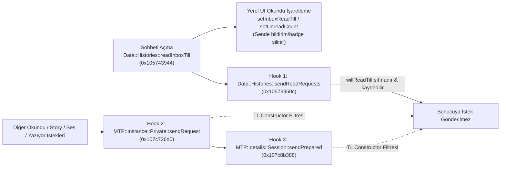

# 👻 telegram-macos-ghost (`tgreverse`)

Native **arm64 Mach-O Ghost Mode ("Görüldü Kapatma") Plugin** for **Telegram Desktop on macOS** (`com.tdesktop.Telegram`).

Suppresses outgoing MTProto read receipts ("Seen" / double-check), story view receipts, voice/media played receipts, typing indicators, and online status directly inside the native Telegram Desktop client—while still clearing local unread badges and desktop notifications on your own screen.

---

## ✨ Özellikler / Features

- **👻 Mesaj Görüldüsünü Kapat (Suppress Read Receipts)** (`⌘⇧G`)
  - Blocks `messages.readHistory`, `channels.readHistory`, `messages.readEncryptedHistory`, `messages.readDiscussion`, `messages.readSavedHistory`, `messages.readMentions`, `messages.readReactions`, `messages.readPollVotes`, and `messages.reportReadMetrics`.
  - **Yerel Okundu Desteği:** Sohbeti açtığında kendi ekranındaki okunmamış rozeti (`setInboxReadTill` / `setUnreadCount`) ve macOS bildirimleri normal şekilde temizlenir; ancak karşı tarafa çift tık ("Görüldü") gitmez.
- **📖 Hikaye (Story) Görüldüsünü Kapat**
  - Blocks `stories.readStories`. Hikayeleri izlediğinde karşı tarafın izleyenler listesinde görünmezsin.
- **🎤 Sesli Mesaj / Medya "Dinlendi" Bilgisini Kapat**
  - Blocks `messages.readMessageContents` & `channels.readMessageContents`.
- **⌨️ "Yazıyor / Kaydediyor..." Bilgisini Gizle** (`⌘⇧T`)
  - Blocks `messages.setTyping` & `messages.setEncryptedTyping`.
- **🕶️ Çevrimiçi (Online) Durumunu Gizle**
  - Rewrites `account.updateStatus(offline=false)` $\rightarrow$ `account.updateStatus(offline=true)` (`0xbc799737` $\rightarrow$ `0x997275b5`) in-flight.
- **✅ Son Sohbete Şimdi Görüldü Gönder (Flush Read Receipt on Demand)** (`⌘⇧R`)
  - Hayalet mod açıkken okuduğun son sohbete istediğin an tek tuşla sunucu üzerinden "Görüldü" gönderebilirsin.
- **🎛️ Pencere İçi Buton + Koyu HUD Panel & Menü Çubuğu**
  - Telegram penceresinin sağ üst köşesine yerleşen **`👻 Hayalet: AÇIK`** butonu, tıklandığında açılan macOS `NSSwitch` kontrol paneli, üst menü (`👻 Hayalet Mod`) ve durum çubuğu (`👻 TG`) entegrasyonu.

---

## 🔬 Reverse Engineering & Mimari / Architecture

Apple Silicon (`arm64`) üzerinde çalışan XNU çekirdeği, imzalı `__TEXT` sayfalarının çalışma zamanında (`VM_PROT_COPY`) değiştirilmesini CDHash doğrulaması nedeniyle `SIGBUS` ile engeller. Bu projede sıfır çalışma zamanı `__TEXT` yaması kullanan hibrit bir **Mach-O Code Cave Trampoline + `LC_LOAD_DYLIB`** mimarisi kullanılmıştır:



### Kancalanan Semboller (Telegram Desktop `7.3.3` arm64)

| Fonksiyon | Sanal Adres | Trampoline (`__TEXT`) | Hook Pointer (`__DATA`) | Görev |
|---|---|---|---|---|
| `Data::Histories::sendReadRequests` | `0x10573950c` | `0x100011200` | `0x10f9c3f00` | `_states` (`+0x40..+0x48`, stride `0x58`) içindeki `willReadTill` (`+0x38`) değerini yakalar ve sıfırlar |
| `MTP::Instance::Private::sendRequest` | `0x107c726d0` | `0x100011220` | `0x10f9c3f08` | `SerializedRequest` (`primes[8]`) içindeki 32-bit TL RPC Constructor ID'sini filtreler |
| `MTP::details::Session::sendPrepared` | `0x107c8b388` | `0x100011240` | `0x10f9c3f10` | `toSendMap` ağ kuyruğuna girmeden önceki son MTProto çıkış kapısı |

### Filtrelenen MTProto TL Constructor ID'leri (`scheme.cpp`)

| TL RPC Metodu | Constructor ID | Kategori |
|---|---|---|
| `messages.readHistory` | `0x0e306d3a` | Mesaj Görüldü (Özel / Grup) |
| `channels.readHistory` | `0xcc104937` | Mesaj Görüldü (Süpergrup / Kanal) |
| `messages.readEncryptedHistory` | `0x7f4b690a` | Mesaj Görüldü (Gizli Sohbet) |
| `messages.readDiscussion` | `0xf731a9f4` | Mesaj Görüldü (Forum / Konu) |
| `messages.readSavedHistory` | `0xba4a3b5b` | Mesaj Görüldü (Kayıtlı Mesajlar) |
| `messages.readMentions` | `0x36e5bf4d` | `@` Bahsetme Görüldü |
| `messages.readReactions` | `0x9ec44f93` | Tepki (Reaction) Görüldü |
| `messages.readPollVotes` | `0x1720b4d8` | Anket Oyu Görüldü |
| `messages.reportReadMetrics` | `0x4067c5e6` | Okundu Telemetrisi |
| `stories.readStories` | `0xa556dac8` | Hikaye (Story) Görüldü |
| `messages.readMessageContents` | `0x36a73f77` | Sesli Mesaj / Medya Açıldı |
| `channels.readMessageContents` | `0xeab5dc38` | Kanal Sesli Mesaj / Medya Açıldı |
| `messages.setTyping` | `0x58943ee2` | Yazıyor / Kaydediyor... |
| `messages.setEncryptedTyping` | `0x791451ed` | Gizli Sohbet Yazıyor... |
| `account.updateStatus` | `0x6628562c` | Çevrimiçi Durumu (`boolFalse` $\rightarrow$ `boolTrue`) |

---

## 🚀 Kurulum / Installation

### Gereksinimler
- macOS (Apple Silicon `arm64`)
- `/Applications/Telegram.app` (Telegram Desktop `com.tdesktop.Telegram` v7.3.3)
- Xcode Command Line Tools (`clang`, `codesign`) & Python 3

### Derleme ve Kurulum
```bash
# Derle, Telegram.app'i yamala ve yeniden başlat
make restart
```

### Canlı Logları İzleme
```bash
make logs
# veya: tail -f /tmp/tg_ghost.log
```

### Kaldırma (Orijinal Binary'yi Geri Yükleme)
```bash
make uninstall
```

---

## ⌨️ Kısayollar & Kontroller / Controls

1. **Telegram Penceresi Sağ Üst Köşe**: **`👻 Hayalet: AÇIK`** butonuna tıklayarak koyu HUD ayar panelini açabilirsin.
2. **macOS Üst Menü**: Telegram aktifken üst menüdeki **`👻 Hayalet Mod`** sekmesinden veya sağ üst sistem çubuğundaki **`👻 TG`** ikonundan erişebilirsin.
3. **Klavye Kısayolları**:
   - `⌘ + ⇧ + G`: Mesaj Görüldüsünü Aç / Kapat
   - `⌘ + ⇧ + T`: "Yazıyor..." Gizlemeyi Aç / Kapat
   - `⌘ + ⇧ + R`: Son Açılan Sohbete Şimdi Görüldü Gönder
   - `⌘ + ⌥ + G`: Hayalet Mod Ayar Panelini Aç / Kapat

---

## 📁 Proje Yapısı

```text
.
├── Makefile            # Derleme, kurulum, yeniden başlatma ve log hedefleri
├── patch_telegram.py   # Mach-O LC_LOAD_DYLIB + __TEXT trampoline yamalayıcı
├── src/
│   └── tg_ghost.m      # Objective-C/C kanca (hook) ve native Cocoa HUD arayüzü
└── LICENSE             # MIT Lisansı
```
