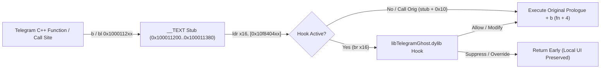

# 👻 telegram-macos-ghost (`tgreverse`) — v2.0

Native **arm64 Mach-O Ghost Mode & Message Protection Plugin** for **Telegram Desktop on macOS** (`com.tdesktop.Telegram` v7.3.3).

Includes **10 live toggles** accessible directly from the in-window **`👻 Hayalet: AÇIK`** titlebar button, a dark translucent **HUD Control Panel**, the macOS menu bar, and keyboard shortcuts:

1. **Mesaj Görüldüsü Kapat (Read Receipts)** — Local unread badges clear normally while outgoing `readHistory` RPCs are suppressed.
2. **Hikaye (Story) Görüldüsü Kapat** — View stories anonymously (`stories.readStories` blocked).
3. **Sesli Mesaj / Medya Açıldı Bilgisi Kapat** — Play voice/video notes without marking them played (`messages.readMessageContents` blocked).
4. **Yazıyor... / Kaydediyor... Gizle** — Suppress typing/recording indicators (`messages.setTyping` blocked).
5. **Çevrimiçi (Online) Durumunu Gizle** — Rewrite `account.updateStatus(offline=false)` to `offline=true` in-place.
6. **🗑️ Silinen Mesajları Yakala (Anti-Delete)** — Intercepts `updateDeleteMessages` / `updateDeleteChannelMessages`, prevents local message destruction, and appends ` [🗑️ Silindi]` to the message bubble in real time.
7. **✏️ Düzenlenen Mesaj Geçmişi (Anti-Edit)** — Intercepts `HistoryItem::applyEdition` and preserves the original text below the edited message as `[✏️ Eski: ...]`.
8. **🔓 Kopyalama / İndirme Kilidi Aç (NoForwards Bypass)** — Unlocks text copying, message forwarding, media saving (`Save File As...`), and screenshots in restricted channels, groups, and private chats.
9. **📸 Ekran Görüntüsü Bildirimi Engelle** — Blocks `messages.sendScreenshotNotification` (`0xa1405817`).
10. **⏱️ Tek Gösterimlik / Süreli Medya Kaydet (TTL Bypass)** — Overrides `Data::MediaPhoto::ttlSeconds` and `Data::MediaFile::ttlSeconds` so view-once and self-destructing media can be opened and saved like regular media.

---

## 🏗️ Architecture & Reverse Engineering Summary

Telegram Desktop (`7.3.3`, `arm64`) compiles its C++ core and MTProto layer into a single 248 MB Mach-O executable (`Contents/MacOS/Telegram`). On Apple Silicon, XNU enforces strict code-signing page hashes on `__TEXT`, preventing runtime `mach_vm_protect` inline patching of code pages.

To achieve **zero runtime page faults** while remaining 100% compatible with macOS code signing:

1. **16 Pre-Signed `__TEXT` Code-Cave Trampolines (`0x100011200..0x100011380`)**:
   - We place 16 compact 6-instruction (24-byte) ARM64 stubs in the unused zero-padded header gap at `0x100011200..0x100011380` (right before `__TEXT,__text` at `0x100011380`).
   - Each stub loads its corresponding 64-bit hook function pointer from writable `__DATA` (`0x10f840400..0x10f840470`). If the pointer is non-null, it branches to `libTelegramGhost.dylib`; otherwise, `stub + 0x10` executes the displaced prologue instruction and branches back to `fn + 4` (which also serves as our direct original-function call trampoline!).



### Hooked Functions & Virtual Addresses (`Telegram 7.3.3 arm64`)

| Hook Name | Static VA | Stub VA | `__DATA` Slot | Role |
|---|---|---|---|---|
| `Data::Histories::sendReadRequests` | `0x10573950c` | `0x100011200` | `0x10f840400` | Captures & zeroes `willReadTill` (`+0x38`) and `willReadWhen` (`+0x40`) |
| `MTP::Instance::Private::sendRequest` | `0x107c726d0` | `0x100011218` | `0x10f840408` | Inspects `SerializedRequest` TL constructor (`d_ptr[8]`) |
| `MTP::details::Session::sendPrepared` | `0x107c8b388` | `0x100011230` | `0x10f840410` | Final gateway before `_toSendMap`; filters read/typing/story/screenshot RPCs |
| `Data::Session::processItemsBeforeDestroy` | `0x1059244f8` | `0x100011248` | `0x10f840418` | Prevents unloading media/replies on server-deleted messages (`5 BL sites`) |
| `History::destroyMessage` | `0x106890d74` | `0x100011260` | `0x10f840420` | Intercepts server delete loops (`5 BL sites`), appends ` [🗑️ Silindi]` via `setText` |
| `HistoryItem::applyEdition` | `0x10690b3b4` | `0x100011278` | `0x10f840428` | Reads `HistoryItem::originalText` (`0x1068f1ff8`) and appends `\n[✏️ Eski: ...]` |
| `Data::MediaPhoto::ttlSeconds` | `0x10577bec8` | `0x100011290` | `0x10f840430` | Overrides `_ttl` (`+0x20`) to `0` for view-once / TTL photos |
| `Data::MediaFile::ttlSeconds` | `0x105781db8` | `0x1000112a8` | `0x10f840430` | Overrides `_ttl` (`+0x20`) to `0` for view-once / TTL videos & files |
| `HistoryItem::allowsForward` | `0x1069119d4` | `0x1000112c0` | `0x10f840438` | Unlocks message forwarding & clears `NoForwards` flags on item/peer |
| `HistoryItem::allowsSaving` | `0x10691261c` | `0x1000112d8` | `0x10f840440` | Unlocks media saving on restricted items |
| `HistoryView::CopyRestrictionTypeForPeer` | `0x10664d5b4` | `0x1000112f0` | `0x10f840448` | Returns `CopyRestrictionType::None (0)` |
| `HistoryInner::hasCopyRestriction` | `0x10695debc` | `0x100011308` | `0x10f840450` | Unlocks text selection copy (`Cmd+C`) in chat view |
| `HistoryInner::hasCopyMediaRestriction` | `0x106961444` | `0x100011320` | `0x10f840458` | Unlocks media context menu save/copy in chat view |
| `OverlayWidget::canSaveMsgFile` | `0x107aeaa98` | `0x100011338` | `0x10f840460` | Enables download/save actions in fullscreen media viewer |
| `OverlayWidget::showCopyMediaRestriction` | `0x107b0b048` | `0x100011350` | `0x10f840468` | Suppresses copy/save restriction toast in fullscreen media viewer |
| `PeerData::allowsForwarding` | `0x1057d445c` | `0x100011368` | `0x10f840470` | Unlocks peer-level forwarding checks (`UserData`/`ChatData`/`ChannelData`) |

### Intercepted 32-bit MTProto TL Constructors (`scheme.cpp`)

| Feature | TL Constructor | Hex ID | Action |
|---|---|---|---|
| **Read Receipts** | `messages.readHistory` | `0x0e306d3a` | Blocked |
| **Read Receipts** | `channels.readHistory` | `0xcc104937` | Blocked |
| **Read Receipts** | `messages.readEncryptedHistory` | `0x7f4b690a` | Blocked |
| **Read Receipts** | `messages.readDiscussion` | `0xf731a9f4` | Blocked |
| **Read Receipts** | `messages.readSavedHistory` | `0xba4a3b5b` | Blocked |
| **Read Receipts** | `messages.readMentions` | `0x36e5bf4d` | Blocked |
| **Read Receipts** | `messages.readReactions` | `0x9ec44f93` | Blocked |
| **Read Receipts** | `messages.readPollVotes` | `0x1720b4d8` | Blocked |
| **Read Receipts** | `messages.reportReadMetrics` | `0x4067c5e6` | Blocked |
| **Story Views** | `stories.readStories` | `0xa556dac8` | Blocked |
| **Voice / Media Played** | `messages.readMessageContents` | `0x36a73f77` | Blocked |
| **Voice / Media Played** | `channels.readMessageContents` | `0xeab5dc38` | Blocked |
| **Typing / Recording** | `messages.setTyping` | `0x58943ee2` | Blocked |
| **Typing / Recording** | `messages.setEncryptedTyping` | `0x791451ed` | Blocked |
| **Screenshot Notify** | `messages.sendScreenshotNotification` | `0xa1405817` | Blocked |
| **Hide Online Status** | `account.updateStatus` | `0x6628562c` | Rewrites `offline=false` (`0xbc799737`) $\to$ `true` (`0x997275b5`) |

---

## 🚀 Installation & Usage

### Prerequisites
- macOS (`arm64` / Apple Silicon)
- Telegram Desktop `7.3.3` installed at `/Applications/Telegram.app`
- Xcode Command Line Tools (`clang`, `codesign`, `python3`)

### Build & Install

```bash
# Build dylib, patch Telegram.app, sign, and restart Telegram:
make restart
```

### Controls & Shortcuts
- **In-Window Button**: Click **`👻 Hayalet: AÇIK`** at the top-right of the Telegram window to open the **Dark HUD Control Panel** (`⌘⌥G`).
- **Menu Bar**: Click **`👻 TG`** in the macOS top-right status bar or **`Hayalet Mod`** in Telegram's application menu bar.
- **`⌘⇧G`**: Toggle Read Receipts (`Görüldü Kapat`)
- **`⌘⇧T`**: Toggle Typing Indicator (`Yazıyor... Gizle`)
- **`⌘⇧R`**: Flush Read Receipt for the last opened chat (`Şimdi Görüldü Gönder`)

### Live Logs & Uninstall

```bash
# Stream real-time blocked/preserved events:
make logs

# Restore original unpatched Telegram.app binary cleanly:
make uninstall
```

---

## 📄 License

MIT License — see [LICENSE](LICENSE).
